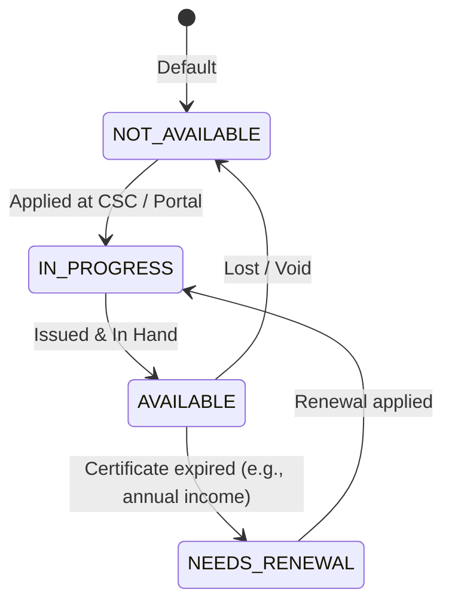
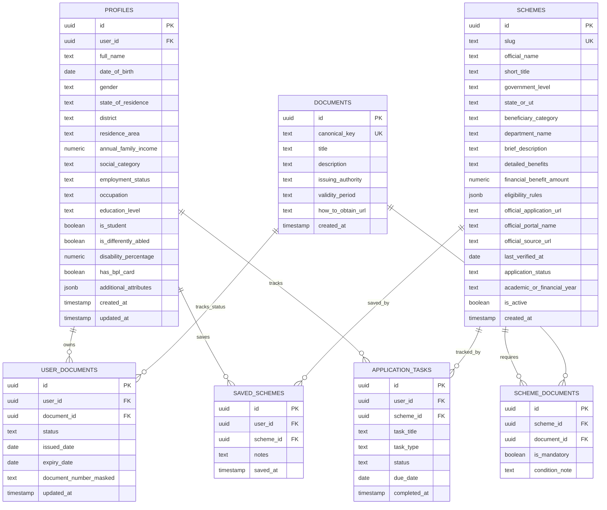

# SAHAYAK - System Architecture & Technical Specification

> **Document Version:** 1.0.0  
> **Status:** Proposed / Under Review  
> **Target Audience:** Engineering Team, Technical Reviewers, Mentors  

---

## 1. Executive Summary & Architectural Principles

**Sahayak** is a civic-technology web platform designed to bridge the gap between Indian welfare schemes and eligible citizens. Rather than functioning simply as a read-only catalog or search directory, Sahayak guides applicants through a deterministic 5-stage pipeline:

```
[ 1. Potential Eligibility ] 
            │
            ▼
[ 2. Requirement Understanding ]
            │
            ▼
[ 3. Document Readiness ]
            │
            ▼
[ 4. Personalised Action Plan ]
            │
            ▼
[ 5. Application Preparation & Tracking ]
```

### Core Architecture Tenets
1. **Deterministic Rule Engine (No Black-Box AI for Eligibility):** Welfare eligibility determines real-world livelihoods. Under no circumstances does a generative Large Language Model (LLM) compute or decide applicant eligibility. Eligibility is calculated by a pure, testable, deterministic rule engine running in TypeScript/PostgreSQL with mathematical tri-state logic (`POTENTIALLY_ELIGIBLE`, `NOT_ELIGIBLE`, `INSUFFICIENT_INFORMATION`).
2. **Transparent & Explainable Outcomes:** Every evaluation returns an audit trail: precisely which criteria passed, which criteria failed, and what pieces of missing profile data prevented a conclusive decision.
3. **Cross-Scheme Document Intelligence:** Most welfare schemes share overlapping documentation requirements (e.g., Domicile, Income Certificate, Ration Card, Bank Passbook). Sahayak models documents as first-class citizens, tracking user readiness once and mapping it across multiple schemes simultaneously.
4. **Zero-Trust Privacy & PII Minimization:** The system never collects or stores Aadhaar numbers. No sensitive identity documents are stored on the server during the MVP. The user's profile is protected by PostgreSQL Row Level Security (RLS).
5. **Verified Scheme Data Integrity:** Every scheme record is tied to an official government department, verified application URL, verified information source, and a verification timestamp.

---

## 2. High-Level System Architecture

```mermaid
flowchart TD
    subgraph Client["Frontend Client (React + Vite + TypeScript)"]
        UI["Civic UI / Tailwind Components"]
        Router["React Router v6"]
        State["State Layer: TanStack Query + Context"]
        Forms["Form Layer: React Hook Form + Zod"]
        ClientEngine["Client-Side Eligibility & Readiness Evaluator"]
    end

    subgraph Supabase["Backend & Data Layer (Supabase / PostgreSQL)"]
        Auth["Supabase Auth (Email / Magic Link)"]
        RLS["PostgreSQL Row Level Security (RLS)"]
        DB[(PostgreSQL Relational DB)]
        EdgeFunctions["Supabase Edge Functions (Deno / TS)"]
    end

    subgraph External["External Services & AI Layer"]
        LLM["AI Assistant (Google Gemini / Anthropic via Edge Function)"]
        GovPortals["Official Government Application Portals (Outbound Links)"]
    end

    UI --> Router
    Router --> Forms
    Forms --> State
    State --> ClientEngine
    State <-->|Supabase Client SDK (HTTPS/WSS)| Auth
    State <-->|PostgreSQL REST API + RLS| RLS
    RLS <--> DB
    State <-->|Secure Invocation| EdgeFunctions
    EdgeFunctions <-->|Grounded Context Prompts| LLM
    UI -.->|Direct Citizen Navigation| GovPortals
```

---

## 3. Technology Stack & Decision Rationale

| Layer | Chosen Technology | Version / Spec | Technical Rationale & Trade-off Analysis |
|---|---|---|---|
| **Frontend Framework** | React + Vite | React 18 / Vite 5+ | Fast compilation, zero-overhead bundler, large ecosystem, standard in modern enterprise web development. |
| **Language** | TypeScript | 5.x (Strict Mode) | Strong static typing is non-negotiable for deterministic eligibility rules, profile schemas, and database entity models. |
| **Styling & Design System** | Tailwind CSS + Lucide React | Tailwind 3.4+ | Utility-first CSS provides high consistency, rapid responsive development, and zero runtime CSS overhead. Lucide offers accessible, recognizable icons for non-technical users. |
| **Routing** | React Router DOM | v6.x | Declarative client-side routing with nested layouts, protected route guards, and scroll restoration. |
| **Form Management & Validation** | React Hook Form + Zod | Latest stable | Uncontrolled form performance with minimal re-renders, paired with Zod schemas that are shared across forms and runtime validation. |
| **Database & Auth** | Supabase (PostgreSQL) | Managed Postgres 15+ | Built-in JSONB querying for dynamic scheme rules, declarative Row Level Security, relational integrity, and robust JWT-based authentication without maintaining custom auth servers. |
| **Serverless / Edge** | Supabase Edge Functions | Deno Runtime | Executes server-side tasks (such as AI Assistant proxying with API key concealment) without spinning up a heavy separate backend service. |
| **Hosting & CI/CD** | Vercel + GitHub | Continuous Deployment | Automated branch previews, SSL, edge caching, and seamless Vite deployment. |

---

## 4. Deterministic Eligibility Engine Architecture

### 4.1 Tri-State Evaluation Model

Standard boolean logic (`true` / `false`) is inadequate for real-world welfare discovery because citizens frequently have incomplete profiles. The engine implements strict **Tri-State Logic**:

```
                    ┌───────────────────────────┐
                    │  Evaluate Scheme Rules    │
                    └─────────────┬─────────────┘
                                  │
         ┌────────────────────────┼────────────────────────┐
         ▼                        ▼                        ▼
┌──────────────────┐    ┌──────────────────┐    ┌──────────────────────┐
│ POTENTIALLY_     │    │   NOT_ELIGIBLE   │    │ INSUFFICIENT_        │
│ ELIGIBLE         │    │                  │    │ INFORMATION          │
├──────────────────┤    ├──────────────────┤    ├──────────────────────┤
│ All mandatory    │    │ At least 1 rule  │    │ No rule failed, but  │
│ conditions       │    │ explicitly       │    │ 1+ conditions cannot │
│ evaluate to PASS │    │ evaluates to     │    │ be evaluated due to  │
│ based on profile.│    │ FAIL.            │    │ missing user info.   │
└──────────────────┘    └──────────────────┘    └──────────────────────┘
```

> **CRITICAL RULE:** *Missing information must NEVER be defaulted or coerced to a pass.* If a scheme requires `income <= 200,000` and the citizen has not entered their annual income, that condition is flagged as `UNKNOWN`, and the overall scheme result is `INSUFFICIENT_INFORMATION`.

### 4.2 Structured Rule Grammar (JSONB Specification)

Rules are stored in the database as structured, human-readable JSON trees. This avoids hardcoding logic in application code and allows non-technical administrators to configure schemes.

```json
{
  "operator": "AND",
  "conditions": [
    {
      "field": "age",
      "operator": "BETWEEN",
      "value": [18, 35],
      "label": "Age must be between 18 and 35 years"
    },
    {
      "field": "gender",
      "operator": "IN",
      "value": ["FEMALE", "TRANSGENDER"],
      "label": "Open to Female and Transgender applicants"
    },
    {
      "field": "annual_family_income",
      "operator": "LESS_THAN_OR_EQUAL",
      "value": 250000,
      "label": "Annual family income must not exceed ₹2,50,000"
    },
    {
      "field": "state_of_residence",
      "operator": "EQUALS",
      "value": "KARNATAKA",
      "label": "Must be a permanent resident of Karnataka"
    },
    {
      "operator": "OR",
      "conditions": [
        {
          "field": "employment_status",
          "operator": "EQUALS",
          "value": "UNEMPLOYED",
          "label": "Currently unemployed"
        },
        {
          "field": "is_student",
          "operator": "EQUALS",
          "value": true,
          "label": "Currently enrolled student"
        }
      ]
    }
  ]
}
```

### 4.3 Evaluation Engine Execution & Explanation Contract

```typescript
export type EvaluationStatus = 'POTENTIALLY_ELIGIBLE' | 'NOT_ELIGIBLE' | 'INSUFFICIENT_INFORMATION';

export interface ConditionResult {
  ruleId: string;
  field: string;
  label: string;
  status: 'PASSED' | 'FAILED' | 'UNKNOWN';
  userValue: unknown;
  expectedValue: unknown;
  reason: string;
}

export interface SchemeEvaluationResult {
  schemeId: string;
  status: EvaluationStatus;
  summary: string;
  passedConditions: ConditionResult[];
  failedConditions: ConditionResult[];
  unknownConditions: ConditionResult[]; // Fields user needs to provide
  missingProfileFields: string[]; // Prompts user to fill these in questionnaire
}
```

---

## 5. Cross-Scheme Document Intelligence Architecture

Document readiness is intentionally decoupled from demographic eligibility:
- Demographic eligibility answers: *"Are you qualified for this scheme?"*
- Document readiness answers: *"Do you have the proof ready to apply today?"*

### 5.1 Universal Document Taxonomy

Documents are normalized using canonical system keys. This prevents duplication across central and state nomenclature:

```
Canonical Key               Official Names & Equivalents
───────────────────────────────────────────────────────────────────────
doc_income_cert       →     Income Certificate, Tehsildar Income Proof
doc_caste_cert        →     Community Certificate, SC/ST/OBC Certificate
doc_domicile_cert     →     Nativity Certificate, Permanent Resident Certificate
doc_ration_card       →     NFSA Card, BPL Card, Antyodaya Anna Yojana Card
doc_bank_passbook     →     Aadhaar-seeded Bank Account Passbook / Statement
doc_marksheet_10      →     SSLC / Class 10 Passing Certificate
doc_marksheet_12      →     HSC / Class 12 Passing Certificate
doc_disability_cert   →     UDID Card, Unique Disability ID Certificate
doc_land_record       →     RoR, Patta / Chitta, 7/12 Extract
```

### 5.2 Document Readiness State Machine

For each document in the universal taxonomy, the citizen records their readiness:



### 5.3 Cross-Scheme Document Matrix & Readiness Score

For any scheme $S$ requiring a set of documents $D_S$:

$$\text{Document Readiness Score} = \left( \frac{|D_S \cap D_{\text{AVAILABLE}}|}{|D_S|} \right) \times 100\%$$

The system highlights **High-Leverage Documents**: documents that unlock the highest number of schemes for the user. (For example: *"Obtaining your Income Certificate will make you document-ready for 4 of your eligible schemes."*)

---

## 6. AI Assistant Architecture & Safety Guardrails

The AI Assistant is an empathetic, plain-language explainer—**never an arbiter of eligibility**.

```
Citizen Query: "Can I get PM Awas Yojana if I live in a rented room in Mumbai?"
                       │
                       ▼
┌────────────────────────────────────────────────────────┐
│  AI Proxy (Supabase Edge Function)                    │
│  - Strip any PII from request                          │
│  - Retrieve verified scheme context from PostgreSQL    │
│  - Build Strict System Prompt with Guardrails          │
└──────────────────────┬─────────────────────────────────┘
                       │
                       ▼
┌────────────────────────────────────────────────────────┐
│  LLM Engine (Gemini / Claude via secure server key)    │
│  - Constraint: Cite official source only               │
│  - Constraint: Explain rules, do not approve/reject    │
│  - Constraint: If uncertain, recommend CSC / Helpline  │
└──────────────────────┬─────────────────────────────────┘
                       │
                       ▼
Citizen Receives: Plain-language summary + Official source link + Verification date
```

### Guardrail Directives
1. **No Decisioning:** The model is explicitly forbidden from saying "You are approved" or "You are guaranteed this benefit."
2. **Strict Grounding:** The model responds only using the provided verified scheme markdown. If the scheme context does not contain the answer, it outputs: *"This specific detail is not specified in our verified records. Please check the official portal at [URL] or visit your nearest Citizen Service Centre (CSC)."*
3. **No Hallucinated URLs or Phone Numbers:** Only URLs stored in the verified database record are returned.

---

## 7. Database Schema & Relational Architecture

The relational schema is implemented in PostgreSQL with strict foreign keys, enums, check constraints, and RLS policies.



---

## 8. Security & Data Privacy Architecture

### 8.1 Zero-Aadhaar & PII Minimization
- **No Aadhaar Collection:** The application explicitly refuses to collect 12-digit Aadhaar numbers or store scans of biometric identity cards. Where identification is tracked, only the *type* of identity document held (e.g. "Voter ID available: Yes") is noted.
- **Client-Side Document Number Masking:** If a user optionally records a certificate registration number for personal reference, it must be masked (e.g. `XXXX-XXXX-1234`).

### 8.2 PostgreSQL Row Level Security (RLS) Policy Specification
Every private table enforces PostgreSQL RLS linked to `auth.uid()`:

```sql
-- Example RLS Policy on Profiles
ALTER TABLE public.profiles ENABLE ROW LEVEL SECURITY;

CREATE POLICY "Users can only view their own profile"
  ON public.profiles FOR SELECT
  USING (auth.uid() = user_id);

CREATE POLICY "Users can only update their own profile"
  ON public.profiles FOR UPDATE
  USING (auth.uid() = user_id);

CREATE POLICY "Users can insert their own profile"
  ON public.profiles FOR INSERT
  WITH CHECK (auth.uid() = user_id);

-- Schemes are publicly readable by all authenticated and unauthenticated citizens
ALTER TABLE public.schemes ENABLE ROW LEVEL SECURITY;

CREATE POLICY "Active schemes are publicly viewable"
  ON public.schemes FOR SELECT
  USING (is_active = true);
```

### 8.3 Environment Separation & Secret Hygiene
- **Frontend Environment (`.env`):** Only contains `VITE_SUPABASE_URL` and `VITE_SUPABASE_ANON_KEY`.
- **Backend / Edge Functions:** `SUPABASE_SERVICE_ROLE_KEY` and AI Provider API keys are strictly confined to serverless function environment variables and never exposed to client bundles.

---

## 9. Proposed Project Folder Structure

```
OOPS_Project/
├── .github/
│   └── workflows/
│       └── ci.yml                 # Build, Lint, and Type-check workflow
├── docs/
│   ├── ARCHITECTURE.md            # System architecture (this document)
│   ├── PROJECT_PLAN.md            # 21-Day phased execution plan
│   ├── DATABASE_SCHEMA.md         # Full SQL DDL, indexes, and RLS definitions
│   ├── API_DOCUMENTATION.md       # Client engine & Edge Function contracts
│   └── SECURITY.md                # Threat model and privacy guidelines
├── supabase/
│   ├── functions/
│   │   └── scheme-assistant/      # Secure AI QA Edge Function
│   ├── migrations/
│   │   ├── 20261112000001_initial_schema.sql
│   │   ├── 20261112000002_rls_policies.sql
│   │   └── 20261112000003_seed_verified_schemes.sql
│   └── config.toml
├── src/
│   ├── assets/                    # Static branding, illustrative icons
│   ├── components/
│   │   ├── common/                # Accessible primitives (Button, Modal, Badge, Card, Tooltip)
│   │   ├── layout/                # Navbar, Footer, MobileNav, DashboardLayout
│   │   ├── eligibility/           # ConditionBreakdown, StatusBadge, MissingFieldAlert
│   │   ├── documents/             # DocumentCard, ReadinessScoreCircle, DocumentMatrix
│   │   └── schemes/               # SchemeCard, SchemeFilters, SchemeHeader, OfficialLinkButton
│   ├── config/
│   │   ├── constants.ts           # States, UTs, Categories, Operator lists
│   │   └── env.ts                 # Validated environment configuration
│   ├── contexts/
│   │   └── AuthContext.tsx        # Supabase Session and User Profile Provider
│   ├── hooks/
│   │   ├── useSchemes.ts          # Scheme query hooks with caching
│   │   ├── useEligibility.ts      # Live rule engine evaluation hook
│   │   ├── useUserDocuments.ts    # User document vault state & mutation hooks
│   │   └── useReadinessScore.ts   # Computed cross-scheme readiness scores
│   ├── lib/
│   │   ├── supabase.ts            # Supabase client singleton
│   │   └── utils.ts               # Formatting (Currency INR, Dates, Sanitization)
│   ├── pages/
│   │   ├── LandingPage.tsx        # Public marketing & value-proposition page
│   │   ├── AuthPage.tsx           # Login / Register / Magic Link
│   │   ├── OnboardingPage.tsx     # Progressive eligibility questionnaire
│   │   ├── DashboardPage.tsx      # Central citizen readiness overview
│   │   ├── SchemesExplorePage.tsx # Scheme directory with faceted filtering
│   │   ├── SchemeDetailPage.tsx   # Detailed scheme view with rule audit breakdown
│   │   ├── DocumentVaultPage.tsx  # Centralized document tracker
│   │   ├── SavedSchemesPage.tsx   # Citizen's bookmarked schemes & readiness
│   │   ├── ProfilePage.tsx        # View & edit demographic attributes
│   │   └── NotFoundPage.tsx       # 404 handler
│   ├── routes/
│   │   ├── AppRoutes.tsx          # Route definitions & code-split lazy loaders
│   │   └── ProtectedRoute.tsx     # Route guard verifying authentication & profile
│   ├── services/
│   │   ├── eligibilityEngine/     # PURE, TESTED RULE EVALUATION ENGINE
│   │   │   ├── evaluator.ts       # Condition tree walker
│   │   │   ├── operators.ts       # Comparison logic (==, >, <, BETWEEN, IN, etc.)
│   │   │   └── types.ts           # Rule grammar AST types
│   │   ├── documentService.ts     # Document taxonomy and readiness math
│   │   ├── schemeService.ts       # Database queries for schemes
│   │   └── aiService.ts           # Safe client proxy to scheme-assistant Edge Function
│   ├── types/
│   │   ├── database.types.ts      # Auto-generated Supabase PostgreSQL types
│   │   ├── scheme.types.ts        # Scheme domain entities
│   │   ├── user.types.ts          # Applicant profile types
│   │   └── document.types.ts      # Document taxonomy types
│   ├── App.tsx                    # Main application wrapper with providers
│   ├── main.tsx                   # DOM entry point
│   └── index.css                  # Tailwind directives and base civic-tech typography
├── .env.example                   # Template for environment variables
├── index.html                     # HTML root with accessible viewport & meta tags
├── package.json                   # Curated, mutually compatible dependencies
├── tsconfig.json                  # Strict TypeScript configuration
├── tsconfig.node.json
├── tailwind.config.js             # Accessible design tokens (contrast-verified colors)
├── postcss.config.js
└── vite.config.ts                 # Path aliases (@/*) and build optimizations
```

---

## 10. Technical Risks & Architectural Mitigations

| # | Technical Risk | Severity | Root Cause | Architectural Mitigation Strategy |
|---|---|---|---|---|
| **R1** | **Outdated Scheme Rules or Dead URLs** | HIGH | Government portals periodically rebrand, migrate domains, or revise eligibility guidelines. | Schemas enforce `last_verified_at` and `official_source_url`. If a scheme has not been verified within 90 days, the UI displays a subtle "Verification Recommended" notice. No scheme is published without an official departmental reference. |
| **R2** | **Complex Conditional Logic Explosion** | HIGH | Government rules often have complex exceptions (e.g. "Relaxation of 5 years for SC/ST, or 3 years for OBC"). | The rule engine supports nested `AND` / `OR` condition blocks with explicit operator types. Highly idiosyncratic rules are captured as typed sub-clauses with explanatory labels so the applicant sees the exact rationale. |
| **R3** | **Hallucinations in AI Assistant** | HIGH | Generative models can invent fake deadlines, incorrect cash grants, or false assurances. | The AI function is strictly isolated from eligibility calculations. It uses a temperature of 0.1, receives only verified scheme documentation as injected context, and is constrained by system prompts to refuse answering ungrounded queries. |
| **R4** | **Data Leakage of Sensitive Demographics** | HIGH | Caste, disability, and income information is highly personal and sensitive. | Zero public endpoints for profile data. PostgreSQL Row Level Security enforces that only the authenticated user matching `auth.uid()` can query or mutate their profile. No social feeds or public user directories exist. |
| **R5** | **Performance on Low-End Mobile Devices** | MEDIUM | Indian citizens frequently access civic websites on budget Android devices and 3G/4G connections. | Vite code-splitting via `React.lazy`, zero heavyweight runtime UI libraries, lightweight Lucide SVG icons, client-side rule evaluation without continuous network roundtrips. |

---

## 11. Verification & Testing Strategy

1. **Unit Testing the Eligibility Engine:** Exhaustive test suite covering all operators (`BETWEEN`, `IN`, `EQUALS`, `LESS_THAN`, etc.), nested `AND`/`OR` groups, edge conditions, and missing-field scenarios (ensuring `INSUFFICIENT_INFORMATION` is produced when data is absent).
2. **Type Invariance:** `tsc --noEmit` runs on every pull request and pre-commit hook to prevent type drift.
3. **Database Migration Verification:** SQL migrations run in an isolated local or preview Supabase environment to verify RLS policies and foreign key constraints before deployment.
4. **Accessibility (a11y) Verification:** Adherence to WCAG 2.1 AA standards for high contrast, keyboard navigation, clear form labels, and screen-reader-friendly status notifications.
