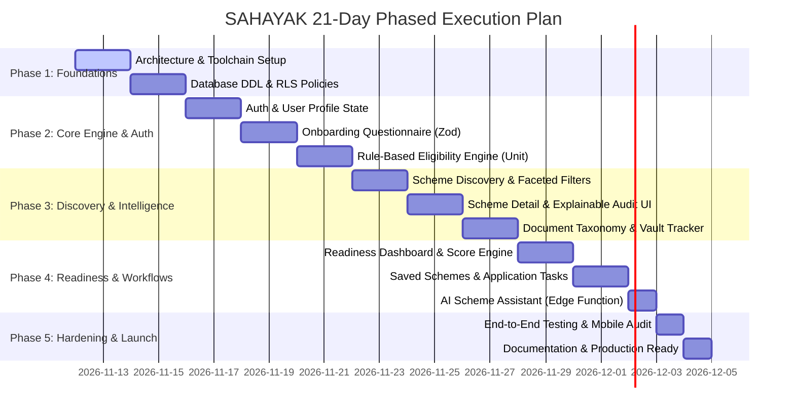

# SAHAYAK - 21-Day Master Implementation Plan & MVP Roadmap

> **Project Name:** SAHAYAK (Civic Welfare Discovery & Application Readiness Platform)  
> **Target Audience:** Indian Citizens across all 28 States & 8 Union Territories  
> **Development Model:** Incremental, Modular, Test-Driven Civic-Tech Engineering  
> **Status:** Phase 0 (Planning & Architecture Approval)  

---

## 1. Product Vision & Target Personas

Sahayak is not a generic welfare directory. Its sole mission is to guide citizens from **potential eligibility** through **document readiness** to **application preparation**.

### 1.1 Target Beneficiary Personas

```
┌─────────────────────────────────────────────────────────────────────────────┐
│ 1. Priya Sharma (College Student, 19, Rural UP)                             │
│    • Needs: Post-matric scholarships, fee reimbursement                     │
│    • Obstacle: Confused by income limits, missing caste & income cert info  │
│    • Sahayak Value: Instant eligibility check + exact steps to get certificates│
├─────────────────────────────────────────────────────────────────────────────┤
│ 2. Ramesh Patel (Small Farmer, 46, Gujarat)                                 │
│    • Needs: Agricultural input subsidies, crop insurance, PM-Kisan          │
│    • Obstacle: Does not know if land record (7/12) is sufficient or outdated│
│    • Sahayak Value: Cross-scheme readiness score + checklist for CSC visit  │
├─────────────────────────────────────────────────────────────────────────────┤
│ 3. Sunita Devi (Self-Employed Tailor, 34, Urban Slum / Semi-Urban, Bihar)    │
│    • Needs: Micro-credit, women entrepreneurship schemes, Ayushman Bharat   │
│    • Obstacle: Inability to decipher complex official notifications         │
│    • Sahayak Value: Plain-language summary + explainable eligibility audit  │
├─────────────────────────────────────────────────────────────────────────────┤
│ 4. Abdul Karim (Senior Citizen, 68, Retired unorganized worker, Kerala)     │
│    • Needs: Old age pension, subsidized healthcare                          │
│    • Obstacle: Low tech literacy, fear of missing deadlines                │
│    • Sahayak Value: Simple high-contrast UI, step-by-step task milestones   │
└─────────────────────────────────────────────────────────────────────────────┘
```

---

## 2. Realistic MVP Scope vs. Post-MVP Scope

To ensure exceptional software quality, maintainability, and zero false promises, the project is strictly divided into **MVP Essentials** and **Post-MVP Enhancements**.

### 2.1 In-Scope for 21-Day MVP

| Module | MVP Scope & Capabilities |
|---|---|
| **A. Public Landing Page** | Value proposition, step-by-step explainer, curated scheme statistics, geographic coverage notice (distinguishing engine coverage from verified database size), responsive header/footer. |
| **B. Auth & Security** | Supabase Email/Password + Magic Link authentication, session persistence, automatic profile initialization, strict PostgreSQL Row Level Security (RLS). |
| **C. Onboarding Questionnaire** | Progressive, mobile-optimized multi-step intake capturing: age, gender, state/UT, category, annual family income, occupation, student status, disability status, ration card status. |
| **D. Applicant Profile Management** | View, edit, and update demographic attributes; re-trigger live scheme re-evaluations whenever attributes change. |
| **E. Scheme Discovery & Filtering** | Faceted search across central & state schemes by category (Education, Agriculture, Healthcare, Social Welfare, Women, Senior Citizens), state, and keyword. |
| **F. Scheme Details Page** | Clear breakdown: Department, benefits, financial support, official portal links, source documents, last verified date, and deadline status. |
| **G & H. Deterministic Eligibility Engine** | Client/DB rule evaluator supporting `AND`/`OR` conditions, comparisons (`<`, `<=`, `>`, `>=`, `==`, `IN`, `BETWEEN`). Returns `POTENTIALLY_ELIGIBLE`, `NOT_ELIGIBLE`, or `INSUFFICIENT_INFORMATION` with explainable passed, failed, and missing-field cards. |
| **I & J. Document Intelligence & Vault** | Universal normalized document taxonomy; citizen-facing Document Vault tracking document availability (`AVAILABLE`, `IN_PROGRESS`, `NEEDS_RENEWAL`, `NOT_AVAILABLE`); per-scheme document checklist. |
| **K. Readiness Dashboard** | Visual readiness meter (% document ready for eligible schemes), top actionable steps, high-leverage document recommendations (documents that unlock multiple schemes). |
| **L. Saved Schemes** | Bookmark schemes for later review; view combined document readiness across all saved schemes. |
| **M. Application Task Tracker** | Interactive milestones per scheme: "Acquire Missing Document" $\rightarrow$ "Register on Official Portal" $\rightarrow$ "Submit Application" $\rightarrow$ "Record Application Reference ID". |
| **N. Grounded AI Scheme Assistant** | Safe, context-constrained explainer for scheme details, answering citizen questions in simple, plain language with zero hallucination and strict disclaimers. |
| **O. Curated Seed Dataset** | 10 verified real-world Indian welfare schemes (Central & representative State schemes) with fully populated rules, document requirements, and verified official URLs. |

### 2.2 Post-MVP Scope (Deferred for Subsequent Releases)
- Automated SMS / WhatsApp status notifications (requires Indian DLT registration & SMS gateway).
- Direct DigiLocker API OAuth document fetching (requires enterprise government sandbox credentials).
- Multi-lingual localization across 12 scheduled Indian languages (i18n engine designed, content translation deferred).
- Direct state portal API submission (requires government MOUs; MVP focuses on preparing citizens for official portals).
- Automated web scrapers for state gazettes (MVP prioritizes human-verified scheme curation for 100% data integrity).

---

## 3. Phased 21-Day Development Roadmap



---

### Detailed Daily Breakdown

#### Phase 1: Foundation, Toolchain & Database Design (Days 1 – 4)
- **Day 1: Project Initialization & Toolchain Configuration**
  - Initialize Vite + React + TypeScript in strict mode.
  - Configure Tailwind CSS with accessible civic-tech design tokens (Slate, Emerald, Amber, Blue palette; WCAG AA contrast).
  - Configure path aliases (`@/components`, `@/services`, `@/types`, etc.) in `vite.config.ts` and `tsconfig.json`.
  - Install dependencies: `lucide-react`, `react-router-dom`, `react-hook-form`, `zod`, `@supabase/supabase-js`, `clsx`, `tailwind-merge`.
  - Establish basic app shell and routing skeleton.
- **Day 2: Architecture Documentation & Guidelines Setup**
  - Commit `ARCHITECTURE.md`, `PROJECT_PLAN.md`, `SECURITY.md`, `DATABASE_SCHEMA.md`.
  - Set up Git hygiene, `.gitignore`, and `.env.example`.
- **Day 3: Supabase Database DDL & Schema Setup**
  - Draft SQL migrations for tables: `profiles`, `schemes`, `documents`, `scheme_documents`, `user_documents`, `saved_schemes`, `application_tasks`.
  - Add PostgreSQL check constraints, unique constraints, and foreign key cascades.
  - Implement and test Row Level Security (RLS) policies for all tables.
- **Day 4: Seed Data Curation (Verified Schemes & Documents)**
  - Curate 10 verified real-world Indian government schemes (Central + State).
  - Curate universal document taxonomy (12 canonical document types).
  - Create seed script / SQL migration with verified application URLs, departments, and structured eligibility rule trees.

#### Phase 2: Authentication, Onboarding & Deterministic Rule Engine (Days 5 – 9)
- **Day 5: Supabase Authentication Integration**
  - Implement Supabase Client singleton (`src/lib/supabase.ts`).
  - Implement `AuthContext` with session monitoring (`onAuthStateChange`).
  - Build clean, accessible Auth page (`/login`, `/register`) with email/password and magic link options.
  - Implement Protected Route guards (`ProtectedRoute.tsx`).
- **Day 6: Applicant Onboarding Questionnaire (Step 1 & 2)**
  - Build progressive multi-step questionnaire with `react-hook-form` and `zod`:
    - Step 1: Basic Demographics (Age, Gender, State, District, Area).
    - Step 2: Social & Economic Profile (Annual Family Income, Social Category, BPL status).
- **Day 7: Applicant Onboarding Questionnaire (Step 3 & Profile Management)**
  - Step 3: Education & Occupation (Student status, Education level, Employment status, Disability).
  - Build auto-saving and profile sync to Supabase `profiles` table.
  - Build Profile Edit view (`/profile`) allowing citizens to modify parameters at any time.
- **Day 8: Deterministic Rule Engine - Core Logic & Operators**
  - Implement pure TypeScript rule evaluator in `src/services/eligibilityEngine/`:
    - Comparison operators: `EQUALS`, `NOT_EQUALS`, `LESS_THAN`, `LESS_THAN_OR_EQUAL`, `GREATER_THAN`, `GREATER_THAN_OR_EQUAL`, `BETWEEN`, `IN`, `CONTAINS`.
    - Logical operators: `AND`, `OR`.
    - Tri-state resolution logic (`POTENTIALLY_ELIGIBLE`, `NOT_ELIGIBLE`, `INSUFFICIENT_INFORMATION`).
- **Day 9: Engine Unit Testing & Explanation Generator**
  - Implement `generateExplanation()` returning clear reasons for passed, failed, and unknown conditions.
  - Write comprehensive automated unit tests for edge cases:
    - Income right at threshold.
    - Missing age or missing income resulting in `INSUFFICIENT_INFORMATION`.
    - Gender matching female-only schemes.
    - State matching state-specific schemes vs central schemes.

#### Phase 3: Discovery, Scheme Intelligence & Document Vault (Days 10 – 14)
- **Day 10: Scheme Discovery & Faceted Search**
  - Build Scheme Explorer (`/schemes`) with real-time client-side and database filtering.
  - Filters: Government level (Central vs State), Target Category, State/UT, Application Status.
  - Search by keyword across scheme title and description.
- **Day 11: Scheme Detail Page & Explainable Eligibility Breakdown**
  - Build Scheme Detail view (`/schemes/:slug`).
  - Display official metadata: Department, benefit amount, verified date, official portal link.
  - Implement the **Explainable Eligibility Audit Card**:
    - Green badges for criteria the citizen meets.
    - Red badges for criteria that disqualify the citizen, with a clear explanation.
    - Amber badges for missing profile items, with a one-click button: *"Update Profile to verify this condition"*.
- **Day 12: Universal Document Taxonomy & Per-Scheme Checklist**
  - Display mandatory and optional documents for each scheme.
  - Provide guidance notes for each document: issuing authority, approximate processing time, and official portal link to obtain it (e.g., e-District, CSC, MeeSeva, Saral Haryana).
- **Day 13: Centralized Document Vault (`/vault`)**
  - Build citizen's personal Document Vault.
  - Allow user to toggle status for each canonical document: `AVAILABLE`, `IN_PROGRESS`, `NEEDS_RENEWAL`, `NOT_AVAILABLE`.
  - Store optional issue dates and renewal reminders.
- **Day 14: Cross-Scheme Document Intelligence**
  - Implement calculation to show how a single document impacts multiple schemes.
  - Display "High Impact Document" recommendations (e.g., *"Getting an Income Certificate unlocks 3 schemes for you"*).

#### Phase 4: Application Readiness, Task Tracker & AI Assistant (Days 15 – 18)
- **Day 15: Application Readiness Dashboard (`/dashboard`)**
  - Build central citizen command center.
  - Display:
    - Overall Readiness Meter (% readiness across eligible schemes).
    - Eligible Schemes Summary (count and estimated financial benefits).
    - Pending Document Actions.
    - Active Application Milestones.
- **Day 16: Saved Schemes & Application Task Tracker**
  - Build Saved Schemes view (`/saved-schemes`) with quick-action toggles.
  - Build interactive Application Task Tracker:
    - Step 1: Collect documents.
    - Step 2: Register on official portal.
    - Step 3: Fill application form.
    - Step 4: Record submission acknowledgement number & date.
- **Day 17: Grounded AI Scheme Assistant (Edge Function & UI Widget)**
  - Implement Supabase Edge Function (`scheme-assistant`) with strict context injection.
  - Embed chat widget in Scheme Detail page allowing citizens to ask questions like:
    - *"What is the income certificate validity period in Karnataka?"*
    - *"Can I apply if my family already owns 2 acres of land?"*
  - Strict guardrail verification: refuses to assess eligibility, returns only grounded facts from official data, includes source links.
- **Day 18: Responsive Polish & Accessible UX Review**
  - Audit all screens on mobile viewports (360px, 390px, 768px, 1024px+).
  - Add accessible keyboard navigation, ARIA attributes, and screen-reader status live-regions.
  - Verify empty states, skeleton loaders, and graceful error boundary fallbacks.

#### Phase 5: Testing, Hardening, Documentation & Delivery (Days 19 – 21)
- **Day 19: End-to-End Verification & User Flow Walkthroughs**
  - Test complete user journeys:
    1. Unauthenticated visitor browses schemes $\rightarrow$ takes questionnaire $\rightarrow$ signs up $\rightarrow$ views customized readiness score.
    2. Citizen updates profile from Student to Employed $\rightarrow$ observes live re-calculation of eligibility.
    3. Citizen marks Income Certificate as `AVAILABLE` in Document Vault $\rightarrow$ watches readiness score jump on Dashboard.
- **Day 20: Performance, Security & Error Audit**
  - Full TypeScript build check (`tsc --noEmit`).
  - Verify zero console errors, zero leaked secrets, zero unhandled promise rejections.
  - Confirm Supabase RLS policies block cross-user data leakage.
- **Day 21: Final Documentation & Presentation Ready**
  - Complete `API_DOCUMENTATION.md`, `DATABASE_SCHEMA.md`, `SECURITY.md`, `DEVELOPMENT_LOG.md`, and updated `README.md`.
  - Prepare user demo script and architecture overview walkthrough.

---

## 4. Curated Seed Dataset Specification (10 Real Schemes)

To ensure zero fake data, the seed dataset contains 10 verified, active Indian welfare schemes:

| # | Official Scheme Name | Level | State/Region | Primary Beneficiaries | Key Eligibility Criteria | Official Portal Link |
|---|---|---|---|---|---|---|
| 1 | **PM-Kisan Samman Nidhi** | Central | All India | Small & Marginal Farmers | Landholding farmer family, not institutional landholder, not income tax payer | `pmkisan.gov.in` |
| 2 | **Ayushman Bharat PM-JAY** | Central | All India | Low-income Households | Deprived rural families / identified occupational urban workers (SECC/NFSA ration card) | `pmjay.gov.in` |
| 3 | **Post Matric Scholarship for SC Students** | Central / State | All India | SC Students (Class 11 to Post-Doc) | SC category, enrolled in recognized post-matric course, family income $\le$ ₹2.5 Lakh/yr | `scholarships.gov.in` |
| 4 | **Post Matric Scholarship for OBC Students** | Central / State | All India | OBC Students | OBC category, family income $\le$ ₹2.5 Lakh/yr, enrolled in recognized institution | `scholarships.gov.in` |
| 5 | **Sukanya Samriddhi Yojana (SSY)** | Central | All India | Girl Child (under 10 years) | Indian girl child aged $< 10$ years, opened by parent/guardian, max 2 girls per family | `indiapost.gov.in` |
| 6 | **Atal Pension Yojana (APY)** | Central | All India | Unorganized Sector Workers | Age 18–40 years, bank account holder, not an income tax payer, not in statutory social security | `npscra.nsdl.co.in` |
| 7 | **Pradhan Mantri Awas Yojana - Gramin (PMAY-G)** | Central | Rural India | Rural Homeless / Kutcha House Dwellers | Houseless or living in 0, 1, or 2 room kutcha house, verified in SECC list | `pmayg.nic.in` |
| 8 | **PM SVANidhi (Street Vendor Loan)** | Central | Urban / Semi-Urban | Urban Street Vendors | Engaged in vending in urban areas on or before specified cutoff date, Certificate of Vending | `pmsvanidhi.mohua.gov.in` |
| 9 | **Yuva Nidhi Scheme** | State | Karnataka | Unemployed Graduates / Diploma Holders | Domicile of Karnataka, graduated in recent academic year, unemployed for $> 6$ months | `sevasindhu.karnataka.gov.in` |
| 10 | **Rythu Bharosa / Rythu Bandhu** | State | Andhra Pradesh / Telangana | Resident Farmers | Land-owning farmer with valid Pattadar Passbook, cultivating eligible crops | `rythubharosa.ap.gov.in` |

---

## 5. Curated Universal Document Taxonomy (Seed)

| Canonical Key | Document Name | Issuing Authority | Primary Schemes Unlocked |
|---|---|---|---|
| `doc_income_cert` | Income Certificate | Revenue Dept / Tehsildar / e-District | Scholarships, Housing, Healthcare, Welfare Pensions |
| `doc_caste_cert` | Caste / Category Certificate (SC/ST/OBC) | Tehsildar / Revenue Sub-Divisional Officer | SC/ST/OBC Scholarships, Skill Schemes, Reservation Benefits |
| `doc_domicile_cert` | Domicile / Residence Certificate | District Administration / Tehsildar | State Welfare Schemes, State Scholarships (e.g. Yuva Nidhi) |
| `doc_ration_card` | Ration Card (NFSA / BPL / AAY) | Food & Civil Supplies Dept | Ayushman Bharat, PMAY-G, PMAY-U, Subsidized Welfare |
| `doc_bank_passbook` | Aadhaar-Seeded Bank Passbook | Nationalized / Commercial Bank / Post Office | Direct Benefit Transfer (DBT) across all 10 schemes |
| `doc_land_record` | Land Record (RoR / 7/12 / Patta) | Revenue Dept / Land Records Portal | PM-Kisan, Rythu Bharosa, Agriculture Subsidies |
| `doc_marksheet_10` | Class 10 Marksheet / Passing Certificate | State / Central Education Board | Post-Matric Scholarships, Higher Education Schemes |
| `doc_marksheet_12` | Class 12 Marksheet | State / Central Education Board | Degree Scholarships, Skill Development |
| `doc_college_id` | Current College Bonafide / Admission Receipt | Recognized College / Institute | All Student Scholarship disbursements |
| `doc_disability_cert` | UDID Card / Disability Certificate | District Medical Board / Swavlamban Portal | Divyangjan Pensions, Assistive Devices, Special Grants |
| `doc_voter_id` | Voter Identity Card (EPIC) | Election Commission of India | Age & Identity verification across general welfare |
| `doc_vending_cert` | Street Vending Certificate / LOR | Urban Local Body (ULB) / Town Vending Comm | PM SVANidhi Street Vendor Loan |

---

## 6. Dependency Plan & Rationalization

All dependencies are chosen for stability, mutual compatibility, security, and minimal bundle footprint:

```json
{
  "dependencies": {
    "react": "^18.3.1",
    "react-dom": "^18.3.1",
    "react-router-dom": "^6.26.0",
    "react-hook-form": "^7.52.0",
    "@hookform/resolvers": "^3.9.0",
    "zod": "^3.23.8",
    "@supabase/supabase-js": "^2.45.0",
    "lucide-react": "^0.439.0",
    "clsx": "^2.1.1",
    "tailwind-merge": "^2.5.2"
  },
  "devDependencies": {
    "@types/react": "^18.3.5",
    "@types/react-dom": "^18.3.0",
    "@types/node": "^22.5.4",
    "@vitejs/plugin-react": "^4.3.1",
    "typescript": "^5.5.4",
    "tailwindcss": "^3.4.11",
    "postcss": "^8.4.45",
    "autoprefixer": "^10.4.20",
    "vite": "^5.4.3"
  }
}
```

*Note: No heavy UI component libraries (like MUI or AntD) that bloat bundle sizes and impose inflexible styling. Tailwind CSS provides full styling freedom and sub-second load times.*

---

## 7. Definition of Done & Quality Gates

Before declaring any phase or module complete:
1. **Compilation Gate:** `npm run build` passes with zero TypeScript warnings or errors under strict mode.
2. **Deterministic Evaluation Gate:** 100% of test cases in the eligibility engine pass, correctly identifying `POTENTIALLY_ELIGIBLE`, `NOT_ELIGIBLE`, and `INSUFFICIENT_INFORMATION`.
3. **Database Security Gate:** Supabase Row Level Security (RLS) is validated; unauthenticated queries to private profiles return 0 rows or 401 Unauthorized.
4. **Responsive UI Gate:** Tested across viewport widths (360px mobile, 768px tablet, 1280px desktop) without horizontal overflow or clipped text.
5. **No Fake Controls:** Every button, tab, search bar, and filter performs a real, observable action.
