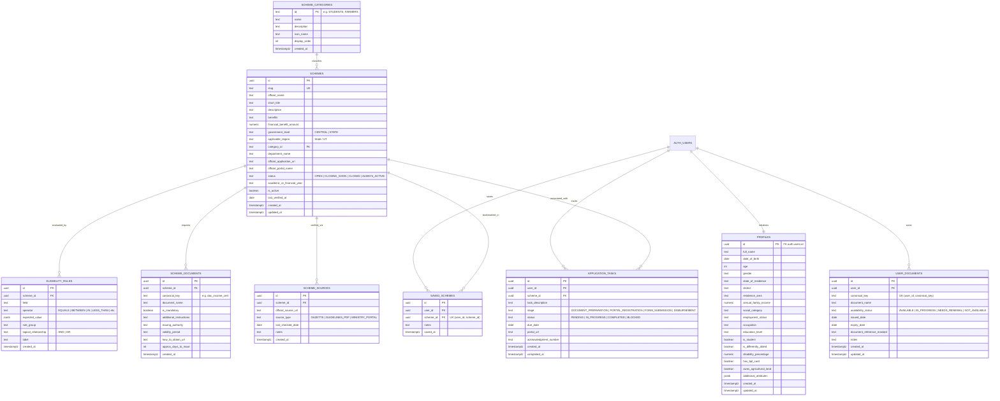

# SAHAYAK - Database Schema Specification & Architecture

> **Database System:** PostgreSQL 15+ (Hosted on Supabase)  
> **Security Model:** Row Level Security (RLS) with Role Isolation  
> **Schema Version:** 1.0.0  
> **Last Updated:** November 2026  

---

## 1. Executive Summary & Design Principles

The **Sahayak** database is architected to balance two competing civic-tech requirements:
1. **Faceted, Publicly Accessible Scheme Discovery:** Citizens, unauthenticated visitors, and community volunteers must be able to search and query government welfare schemes without privacy barriers or mandatory authentication.
2. **Airtight Isolation of Sensitive Personal Data:** Caste, income, disability status, and certificate records are strictly segregated. No citizen may ever access another citizen's profile or document status.

### Core Architectural Decisions
- **Zero-Aadhaar Collection:** The database contains no column or table for storing 12-digit Aadhaar numbers or biometric credentials.
- **Relational Integrity with Cascading Deletions:** If a scheme is modified or removed by administrators, all associated rules, documents, and sources cascade cleanly. If a user deletes their account, their profile, document records, saved schemes, and application tasks are permanently erased in compliance with data privacy standards.
- **Automatic Audit Fields:** Triggers automatically update `updated_at` timestamps on row mutation. When a new user confirms their account in `auth.users`, a database trigger automatically initializes their `public.profiles` row.

---

## 2. Entity-Relationship (ER) Diagram



---

## 3. Data Dictionary

### 3.1 `scheme_categories`
Catalog of target beneficiary portfolios.
- **`id`** (`TEXT`, PK): Canonical identifier (e.g., `'STUDENTS'`, `'FARMERS'`, `'WOMEN'`, `'HEALTHCARE'`).
- **`name`** (`TEXT`, NOT NULL): Human-readable name for UI badges and menus.
- **`description`** (`TEXT`): Explanatory note.
- **`icon_name`** (`TEXT`): Lucide icon identifier (e.g. `'GraduationCap'`).
- **`display_order`** (`INT`): Sorting priority.

### 3.2 `schemes`
The verified government welfare registry.
- **`id`** (`UUID`, PK): Primary key (`gen_random_uuid()`).
- **`slug`** (`TEXT`, UNIQUE, NOT NULL): URL slug (e.g., `'pm-kisan-samman-nidhi'`).
- **`official_name`** (`TEXT`, NOT NULL): Full legal gazette name.
- **`short_title`** (`TEXT`, NOT NULL): Common citizen title (e.g., `'PM-Kisan'`).
- **`description`** (`TEXT`, NOT NULL): Concise summary.
- **`benefits`** (`TEXT`, NOT NULL): Detailed financial assistance & service provisions.
- **`financial_benefit_amount`** (`NUMERIC(12, 2)`): Annual INR monetary value (if quantifiable).
- **`government_level`** (`TEXT`, CHECK: `'CENTRAL' | 'STATE'`): Jurisdictional tier.
- **`applicable_region`** (`TEXT`): State/UT name (e.g. `'Karnataka'`) or `NULL` for Central pan-India.
- **`category_id`** (`TEXT`, FK): References `scheme_categories(id)`.
- **`department_name`** (`TEXT`, NOT NULL): Sponsoring ministry or department.
- **`official_application_url`** (`TEXT`, NOT NULL): Direct verified `.gov.in` submission window.
- **`official_portal_name`** (`TEXT`, NOT NULL): Portal domain (e.g., `'scholarships.gov.in'`).
- **`status`** (`TEXT`, CHECK: `'OPEN' | 'CLOSING_SOON' | 'CLOSED' | 'ALWAYS_ACTIVE'`): Window status.
- **`academic_or_financial_year`** (`TEXT`): e.g., `'AY 2026-27'`.
- **`is_active`** (`BOOLEAN`, DEFAULT `true`): Visibility switch.
- **`last_verified_at`** (`DATE`, NOT NULL): Gazette verification timestamp.

### 3.3 `eligibility_rules`
Atomic criteria evaluated by the deterministic rule engine.
- **`scheme_id`** (`UUID`, FK): References `schemes(id)` on delete cascade.
- **`field`** (`TEXT`, NOT NULL): Target profile attribute (`'annual_family_income'`, `'age'`, `'gender'`, `'social_category'`).
- **`operator`** (`TEXT`, CHECK: `'EQUALS'`, `'NOT_EQUALS'`, `'LESS_THAN'`, `'LESS_THAN_OR_EQUAL'`, `'GREATER_THAN'`, `'GREATER_THAN_OR_EQUAL'`, `'BETWEEN'`, `'IN'`, `'CONTAINS'`).
- **`expected_value`** (`JSONB`, NOT NULL): Typed value (e.g., `250000`, `["GRADUATE", "DIPLOMA"]`, `[18, 40]`).
- **`rule_group`** (`TEXT`, DEFAULT `'default'`): Group identifier for composite conditions.
- **`logical_relationship`** (`TEXT`, CHECK: `'AND' | 'OR'`): Conjunction logic.
- **`label`** (`TEXT`, NOT NULL): Natural language explanation rendered on the audit card.

### 3.4 `scheme_documents`
Universal document mapping.
- **`canonical_key`** (`TEXT`, NOT NULL): Universal token (e.g., `'doc_income_cert'`).
- **`document_name`** (`TEXT`, NOT NULL): Descriptive title.
- **`is_mandatory`** (`BOOLEAN`, DEFAULT `true`): Mandatory vs optional.
- **`issuing_authority`** (`TEXT`): Authority issuing the paper (e.g. `'Tehsildar'`).
- **`validity_period`** (`TEXT`): Duration (e.g., `'1 Financial Year'`).
- **`how_to_obtain_url`** (`TEXT`): Guidance portal (e.g. `'services.india.gov.in'`).
- **`approx_days_to_issue`** (`INT`): Estimated turnaround.

### 3.5 `profiles` (Private)
Private citizen demographics.
- **`id`** (`UUID`, PK): Foreign key to `auth.users(id)` on delete cascade.
- **`full_name`** (`TEXT`): Citizen display name.
- **`date_of_birth`** (`DATE`), **`age`** (`INT`): Age parameters.
- **`gender`** (`TEXT`, CHECK: `'MALE' | 'FEMALE' | 'TRANSGENDER' | 'OTHER'`).
- **`state_of_residence`**, **`district`**, **`residence_area`**: Geographic bounds.
- **`annual_family_income`** (`NUMERIC(12, 2)`): Total family income.
- **`social_category`** (`TEXT`, CHECK: `'GENERAL' | 'OBC' | 'SC' | 'ST' | 'EWS'`).
- **`employment_status`**, **`occupation`**, **`education_level`**: Vocational bounds.
- **`is_student`**, **`is_differently_abled`**, **`has_bpl_card`**, **`owns_agricultural_land`**: Boolean flags.
- **`additional_attributes`** (`JSONB`): Extensible profile bag.

### 3.6 `user_documents` (Private)
Citizen's Universal Document Vault.
- **`user_id`** (`UUID`, FK): References `auth.users(id)`.
- **`canonical_key`** (`TEXT`): Maps to standard taxonomy.
- **`availability_status`** (`TEXT`, CHECK: `'AVAILABLE' | 'IN_PROGRESS' | 'NEEDS_RENEWAL' | 'NOT_AVAILABLE'`).
- **`issued_date`**, **`expiry_date`**: Dates for expiration monitoring.
- **`document_reference_masked`** (`TEXT`): Masked certificate ID (e.g. `'UP-INC-XXXX-9912'`).

### 3.7 `saved_schemes` (Private)
Citizen bookmarks.
- **`user_id`** (`UUID`, FK), **`scheme_id`** (`UUID`, FK): Unique pair `(user_id, scheme_id)` preventing duplicate bookmarks.
- **`notes`** (`TEXT`): Personal citizen annotations.

### 3.8 `application_tasks` (Private)
Interactive milestone tasks.
- **`user_id`** (`UUID`, FK), **`scheme_id`** (`UUID`, FK).
- **`task_description`** (`TEXT`).
- **`stage`** (`TEXT`, CHECK: `'DOCUMENT_PREPARATION' | 'PORTAL_REGISTRATION' | 'FORM_SUBMISSION' | 'DISBURSEMENT_AND_TRACKING'`).
- **`status`** (`TEXT`, CHECK: `'PENDING' | 'IN_PROGRESS' | 'COMPLETED' | 'BLOCKED'`).
- **`acknowledgment_number`** (`TEXT`): Official reference ID recorded by citizen.

---

## 4. Row Level Security (RLS) Policy Specifications

| Table | Policy Name | Permitted Roles | Condition (USING / WITH CHECK) |
|---|---|---|---|
| `scheme_categories` | Public view categories | `anon`, `authenticated` | `USING (true)` |
| `schemes` | Public view active schemes | `anon`, `authenticated` | `USING (is_active = true)` |
| `eligibility_rules` | Public view active rules | `anon`, `authenticated` | `USING (EXISTS (SELECT 1 FROM schemes WHERE schemes.id = eligibility_rules.scheme_id AND schemes.is_active = true))` |
| `scheme_documents` | Public view active docs | `anon`, `authenticated` | `USING (EXISTS (SELECT 1 FROM schemes WHERE schemes.id = scheme_documents.scheme_id AND schemes.is_active = true))` |
| `scheme_sources` | Public view sources | `anon`, `authenticated` | `USING (EXISTS (SELECT 1 FROM schemes WHERE schemes.id = scheme_sources.scheme_id AND schemes.is_active = true))` |
| `profiles` | User own profile access | `authenticated` | `auth.uid() = id` (ALL operations) |
| `user_documents` | User own document access | `authenticated` | `auth.uid() = user_id` (ALL operations) |
| `saved_schemes` | User own bookmarks access | `authenticated` | `auth.uid() = user_id` (ALL operations) |
| `application_tasks` | User own tasks access | `authenticated` | `auth.uid() = user_id` (ALL operations) |

---

## 5. How to Run Migrations in Your Supabase Project

When you are ready to link a live Supabase backend:

1. **Sign in to Supabase:** Go to [supabase.com](https://supabase.com) and create a new project (e.g., `sahayak-prod`).
2. **Open the SQL Editor:** In your Supabase Dashboard, click on **SQL Editor** in the left sidebar.
3. **Execute the Migration Files in Order:**
   - Copy & Run [20261112000001_initial_schema.sql](file:///C:/Users/varch/codes/OOPS_Project/supabase/migrations/20261112000001_initial_schema.sql).
   - Copy & Run [20261112000002_rls_policies.sql](file:///C:/Users/varch/codes/OOPS_Project/supabase/migrations/20261112000002_rls_policies.sql).
   - Copy & Run [20261112000003_seed_verified_data.sql](file:///C:/Users/varch/codes/OOPS_Project/supabase/migrations/20261112000003_seed_verified_data.sql).
4. **Update `.env`:** Copy your **Project URL** and **anon public key** from *Settings $\rightarrow$ API* into your local `.env` file:
   ```env
   VITE_SUPABASE_URL="https://your-project-id.supabase.co"
   VITE_SUPABASE_ANON_KEY="eyJhbGciOiJIUzI1NiIsInR5cCI6..."
   ```
5. **Restart Dev Server:** The application will immediately switch from offline seed mode to your live PostgreSQL database!
